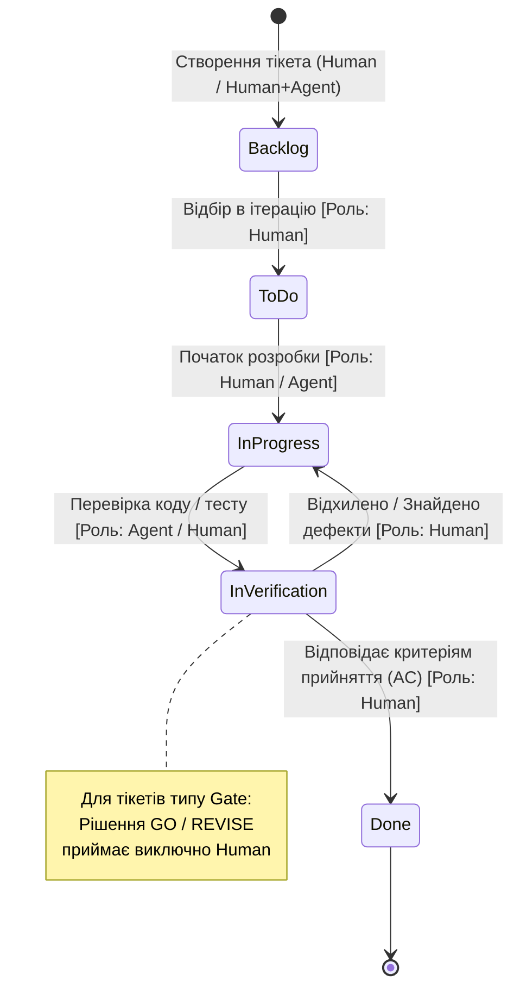

# Життєвий цикл задачі (Task Lifecycle Workflow)

## 1. Ролі учасників проєкту
* **Human (Людина):** Інженер/архітектор — формулює вимоги, визначає пріоритети, проводить верифікацію, виконує Code Review та одноосібно приймає рішення на контрольних точках (Gate).
* **AI Agent (GitHub Copilot):** Кодинговий агент — виконує генерацію коду, підготовку каркасів автотестів і технічну декомпозицію.
* **Human + Agent:** Спільна взаємодія в режимі парного програмування або діалогу.

---

## 2. Діаграма станів задачі (State Machine)

## 3. Таблиця станів і переходів задач

| Початковий стан | Цільовий стан | Умова / Подія переходу | Дозволені ролі |
|---|---|---|---|
| Створення | Backlog | Нова задача сформована та прив'язана до вимоги SRS | Human, Human + Agent |
| Backlog | To Do | Задачу пріоритизовано та відібрано до поточної ітерації | Human |
| To Do | In Progress | Створено робочу гілку, розпочато розробку чи генерацію | Human, Agent |
| In Progress | In Verification | Код або тести згенеровано, створено Pull Request | Agent, Human |
| In Verification | In Progress | Виявлено дефекти, невідповідність SRS або впали тести | Human |
| In Verification | Done | Критерії прийняття (AC) виконано, тести пройдено, PR затверджено | Виключно Human |
| Будь-який стан (Gate) | Approved (Done) | Чеклист контрольної точки перевірено, ухвалено рішення GO | Виключно Human |
| Будь-який стан (Gate) | Rejected (Revise) | Виявлено прогалини/блокери, ухвалено рішення REVISE | Виключно Human |